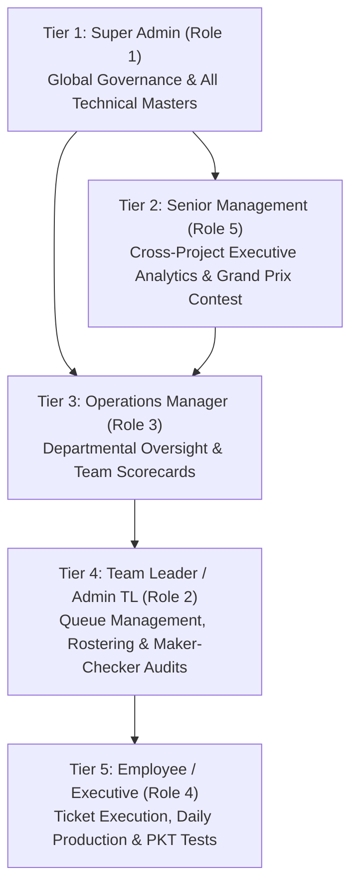

# DM-Ispark: End-to-End System Architecture, Hierarchy & Operational Guide
**Business Operations & Performance Management System**  
**Version:** 2.5 Enterprise (Tabler Design System & PHP MVC Architecture)  
**Document Location:** `C:\VARUN VK\Antigravity\DM - MAIL PORTAL\mail-query-tracker\DM_ISPARK_END_TO_END_SYSTEM_GUIDE.md`

---

## Executive Summary & System Philosophy

**DM-Ispark** is a centralized, high-throughput enterprise operations and performance management platform designed for mission-critical business process outsourcing, transactional processing, and multi-tier operations.

The platform unifies **two core operational paradigms**:
1. **Ticket & Workflow Processing**: Customer queries, multi-stage task pipelines, SLA tracking, Maker-Checker review gates, and hold management.
2. **Production Count-Based Processing**: High-volume unit output logging, dynamic KPI point benchmarks, productivity scoring, and gamification.

The system is built on a clean **PHP 8.2 MVC architecture** (No heavy client-side frameworks, pure server-rendered security with CSRF tokens, PDO prepared statements, and session protection), styled with **Tabler Core (Bootstrap 5)** and **Tabler Icons**.

---

## 1. What Happens During & After a System Reset?

The platform includes a dedicated, secure **Full Project Reset Engine** accessible only to the Super Admin via `Settings -> Reset System` (`/settings/reset`).

### 1.1 The Reset Trigger & Security Gate
1. The user must be authenticated with **Role ID 1 (Super Admin)**.
2. The user must submit a valid **CSRF token**.
3. The user must confirm the action by typing the exact string: `RESET`.
4. The user must provide the Super Admin password (verified via `password_verify` against bcrypt hash).

### 1.2 Database Changes During Reset (`Settings::reset()`)
When the reset executes:
```sql
SET FOREIGN_KEY_CHECKS = 0;
```
1. **Operational & Master Tables are Truncated** and their `AUTO_INCREMENT` is reset to `1`:
   - **Ticketing & Tasks**: `tickets`, `ticket_comments`, `ticket_history`, `ticket_categories`, `task_tickets`, `tasks`, `task_comments`
   - **Trackers**: `contacts`, `error_tracker`, `input_tracker`, `delivery_tracker`, `process_updates`, `hold_history`
   - **Recurring & Audits**: `recurring_templates`, `recurring_tasks`, `audit_logs`, `notifications`
   - **Technical Masters**: `sub_activities`, `activities`, `divisions`
2. **User Table Purge**:
   - All non-superadmin user accounts are deleted:
     ```sql
     DELETE FROM users WHERE role_id != 1;
     ```
   - The primary **Super Admin** account (`id: 1`, `user_code: EMP001`, `full_name: Super Admin`) is **permanently preserved**.
   - `users` table `AUTO_INCREMENT` is reset to the next available ID.
3. **Filesystem Cleanup**:
   - The entire `public/uploads/` directory is purged of all user attachments, PDFs, Excel sheets, and documents (preserving only `.gitkeep`).
4. **Audit Trail Initialization**:
   - A fresh system audit record is created:
     `System | FULL_PROJECT_RESET | Reset by Super Admin (User ID 1)`.
5. **Session & Security State**:
   - Super Admin remains logged in and is redirected to `/dashboard` with a success alert:
     > *"Full Project Reset Complete! All operational data and non-superadmin accounts have been wiped. Super Admin account retained for fresh setup!"*

```sql
SET FOREIGN_KEY_CHECKS = 1;
```

---

## 2. Organizational Hierarchy & Role Architecture

DM-Ispark enforces a strict 5-tier hierarchical governance model. Reporting relationships determine data visibility, ticket allocation, scorecard reviews, and downline tracking.



### 2.1 Role Definitions & Privileges

| Role ID | Role Name | Primary Responsibilities | Downline Visibility Scope | Self-Edit Allowed? |
| :---: | :--- | :--- | :--- | :---: |
| **1** | **Super Admin** | Full technical master setup, global settings, database backup/restore, access rights management, system reset, all downlines. | **Global (100% of Users)** | ❌ No (Self detail hidden from Employee Register) |
| **5** | **Senior Management** | Executive oversight, SLA compliance, cross-project dashboards, Grand Prix Contest, team rankings. | **All Downlines** (Managers, TLs, Employees reporting directly or indirectly) | ❌ No |
| **3** | **Manager** | Departmental operations, manager-level scorecards, team performance reviews, shift rosters. | **All Downlines** (TLs and Employees within reporting tree) | ❌ No |
| **2** | **Admin (TL)** | Direct team queue monitoring, task allocation, daily shift scheduling, Maker-Checker rework audits, PKT authoring. | **Direct Team Downlines** (Assigned Employees) | ❌ No |
| **4** | **Employee** | Daily ticket execution ("My Bucket"), input processing, daily unit count logging, taking PKT exams. | **Self Only** (No downlines) | ❌ No |

### 2.2 Strict Downline Scoping & Self-Edit Restriction Rules
To prevent corporate governance conflicts of interest:
1. **BFS Recursive Downline Engine** (`User_model::getDownlineUserIds`):
   - When a manager or TL opens Employee Management, Performance Scorecards, or Slicers, the system executes a Breadth-First Search (BFS) starting from their `user_id`.
   - Only users who exist in that manager's direct or indirect reporting tree are loaded.
2. **Self-Detail & Self-Edit Exclusion**:
   - The logged-in user's own profile is **strictly excluded** from the Employee Management register (`WHERE id != ?` and template-level skip filters).
   - An employee or manager cannot edit their own designation, role, manager mapping, or aligned sub-activities in the admin panel.
   - Profile changes (phone, password) are isolated to `/profile` and `/change-password`.

---

## 3. End-to-End Post-Reset Setup Flow (Step-by-Step)

After a reset or fresh installation, the system must be populated in a logical, dependency-driven sequence:

```
[Phase 1: Global Setup & Technical Masters]
   │
   ├── 1. Verify Global Settings (/settings)
   ├── 2. Create Projects & Operation Modes (/master/projects)
   ├── 3. Create Business Divisions (/master/divisions)
   ├── 4. Create Activities (/master/activities)
   ├── 5. Create Granular Sub-Activities & SLA (/master/subactivities)
   └── 6. Create Ticket Categories (/master/categories)
   │
[Phase 2: Organizational Hierarchy & People]
   │
   ├── 7. Create Senior Management & Operations Managers (/employees)
   ├── 8. Create Team Leaders & Assign Reporting Managers (/employees)
   ├── 9. Create Employees & Assign Team Leaders (/employees)
   ├── 10. Map Skill Matrix & Maker-Checker Roles (/employees/skill-matrix)
   └── 11. Configure Dynamic Role Permissions (/access-rights)
   │
[Phase 3: Workflows & Queue Engines]
   │
   ├── 12. Define Process Queues & Capacities (/queues)
   └── 13. Build Visual Workflow Pipeline Stages (/workflows)
   │
[Phase 4: Operational Readiness]
   │
   ├── 14. Schedule Monthly Shift Rosters (/roster)
   ├── 15. Upload Client Contacts Directory (/contacts)
   └── 16. Author Process Knowledge Question Bank & KT Plans (/training)
```

---

### Step 1: Technical Masters Configuration (`Administration` Module)

1. **Global System Settings (`/settings`)**:
   - Set Application Title (e.g., `DM-Ispark Enterprise Portal`).
   - Configure global default SLA TAT (e.g., `24` hours).
   - Set Session Inactivity Timeout (e.g., `30` minutes).
   - Enable/disable `auto_assign_employee` and `notify_on_assignment`.

2. **Projects & Teams (`/master/projects`)**:
   - Set up operational accounts (e.g., *MetLife Accounts*, *Aetna Healthcare*, *Prudential Agency*).
   - Define **Operation Mode**:
     - `ticket_workflow`: Multi-stage ticket & lifecycle tracking enabled.
     - `production_count`: Direct daily production unit count logger enabled.
     - `hybrid`: Both ticketing and daily output logging active simultaneously.

3. **Divisions Master (`/master/divisions`)**:
   - Create high-level business departments (e.g., `Billing & Finance`, `Vendor Management`, `Agency Services`, `Internal Operations`).
   - Assign unique short codes (e.g., `BF`, `VM`, `AS`, `IO`).

4. **Activities Master (`/master/activities`)**:
   - Map operational activities under each division (e.g., Division `Billing & Finance` -> Activity `Agency Billing`, `Escrow Reconciliations`).

5. **Sub-Activities Master (`/master/subactivities`)**:
   - Define granular work units (e.g., `Billing Query`, `Commission Run`, `Direct Debit Mandates`).
   - Configure **Default SLA TAT Hours** (e.g., 4h, 8h, 24h, 48h).
   - Assign optional Default Assignee for automatic routing.

6. **Category Master (`/master/categories`)**:
   - Classify tickets into query types (e.g., *General Inquiry*, *Payment Discrepancy*, *Contract Clarification*, *Urgent Exception*).

---

### Step 2: User Onboarding & Reporting Hierarchy (`People` Module)

Users must be created **from top to bottom** so that reporting managers are available in dropdowns:

1. **Create Senior Management (Role 5)**:
   - Go to `/employees` -> Click **Create User Account**.
   - Role: `Senior Management`. Reporting Manager: `None` (or Super Admin).
2. **Create Operations Managers (Role 3)**:
   - Role: `Manager`. Reporting Manager: Select the Senior Management user.
3. **Create Team Leaders (Role 2)**:
   - Role: `Admin (TL)`. Reporting Manager: Select the Operations Manager.
4. **Create Employees / Executives (Role 4)**:
   - Role: `Employee`. Reporting Manager: Select their respective Team Leader.
5. **Verify Org Hierarchy Tree (`/master/hierarchy`)**:
   - Open the dynamic visual Org Tree to verify all reporting lines, designations, and departments connect properly.

---

### Step 3: Skill Matrix & Maker-Checker Mapping (`/employees/skill-matrix`)

DM-Ispark includes a granular **Skill Matrix Hub**:
- For each employee, map the specific sub-activities they are qualified to process.
- Set their proficiency tier: **L1 (Basic/Novice)**, **L2 (Proficient)**, or **L3 (SME/Expert)**.
- Designate operational responsibilities:
  - **Maker**: Authorized to pick and draft/process tasks.
  - **Checker**: Authorized to review, audit, approve, or rework Maker submissions.

---

### Step 4: Access Rights & Permission Matrix (`/access-rights`)

The platform features an in-memory, instant-sync **Dynamic RBAC Engine**:
- Super Admin can toggle view access, Create, Edit, and Delete privileges for every page across all 9 modules for each role (Roles 2, 3, 4, 5).
- Custom user-specific overrides can be saved if an individual needs specialized elevated access.
- Any change saved by Super Admin reflects **immediately across all active user sessions** without requiring re-login.

---

## 4. End-to-End Operational Lifecycle & Modules

Once master configuration and users are established, day-to-day operations flow seamlessly through the 9 modules.

```
       ┌────────────────────────────────────────────────────────┐
       │                INCOMING WORK INGESTION                 │
       │   Manual Ticket Creation  OR  Outlook Parser (CRON)    │
       └───────────────────────────┬────────────────────────────┘
                                   │
                                   ▼
       ┌────────────────────────────────────────────────────────┐
       │             ALLOCATION & "MY BUCKET" QUEUE             │
       │   Auto-Assigned or TL Allocated -> Maker Picks Task    │
       └───────────────────────────┬────────────────────────────┘
                                   │
                                   ▼
       ┌────────────────────────────────────────────────────────┐
       │         12-STAGE LIFECYCLE & MAKER-CHECKER GATE        │
       │  Input Received -> Maker Work -> Checker QC -> Rework  │
       └───────────────────────────┬────────────────────────────┘
                                   │
                 ┌─────────────────┴─────────────────┐
                 ▼                                   ▼
       ┌───────────────────┐               ┌───────────────────┐
       │   HOLD / RELEASE  │               │     DELIVERY      │
       │  SLA Clock Paused │               │ Outbound Dispatch │
       └───────────────────┘               └─────────┬─────────┘
                                                     │
                                                     ▼
       ┌────────────────────────────────────────────────────────┐
       │               OUTPUT LOGGING & SCORECARDS              │
       │ Daily Production -> SLA Compliance -> Grand Prix Race  │
       └────────────────────────────────────────────────────────┘
```

---

### Module 1: Workspace (`/home`, `/dashboard`, `/tickets/my-bucket`, `/roster`)
- **Home Hub (`/home`)**: Launchpad summarizing active tasks, pending reviews, shift status, and quick shortcuts.
- **Executive Dashboard (`/dashboard`)**: Interactive analytics showing Total Ticket Volume, Active Open, Overdue SLA, On-Hold, SLA Compliance %, and Employee Workload Charts. Includes **6 interactive slicers**: Division, Activity, Employee, Priority, Start Date, End Date.
- **My Bucket (`/tickets/my-bucket`)**: Personalized operational queue showing tickets assigned to the logged-in user, color-coded by urgency (Green = Within TAT, Yellow = Due Today, Red = Overdue).
- **Daily Roster (`/roster`)**: Shift calendar where Team Leaders schedule Morning, Afternoon, General, or Night shifts, and log daily attendance.

---

### Module 2: Tasks & Tickets (`/tickets`, `/tickets/create`, `/tasks`, `/lifecycle`)
- **Create Mail Ticket (`/tickets/create`)**:
  - Ingests mail subject, sender, division, activity, sub-activity, priority.
  - Automatically calculates target SLA datetime using business hours and sub-activity SLA.
  - Generates unique ticket number (e.g., `TKT-20261013-0042`).
- **Ticket Details & Action Hub (`/tickets/view/{id}`)**:
  - Full audit history, comments thread, file attachments.
  - Maker submits draft to Checker.
  - Checker can **Approve & Mark Completed** or **Trigger Rework** back to Maker.
- **12-Stage Lifecycle Tracker (`/lifecycle`)**:
  - Visual enterprise pipeline stepper tracking tickets across all 12 operational stages:
    1. *Input Received*
    2. *Maker Queue*
    3. *Checker Queue*
    4. *Error Log*
    5. *Maker Checker Rework*
    6. *Delivery*
    7. *Acknowledgement*
    8. *Approval Queue*
    9. *Uploader Queue*
    10. *Dump Sharing*
    11. *Consol Vendor Tracker*
    12. *Closed*

---

### Module 3: Operational Trackers (`/tracker/query`, `/hold`, `/tracker/input`, `/tracker/delivery`, `/tracker/process-updates`, `/error-tracker`)
- **Query Tracker (`/tracker/query`)**: Logs customer inquiries, internal clarifications, pending replies, and resolution timestamps.
- **Hold / Release List (`/hold`)**: When external dependencies (missing client data, waiting for approval) arise, tickets are placed on hold. **The SLA clock pauses**, and automatically resumes when released.
- **Input Tracker (`/tracker/input`)**: Logs raw incoming file batches, batch references, sender email, and receipt timestamps.
- **Delivery Tracker (`/tracker/delivery`)**: Tracks dispatch of completed outputs (Email, SFTP, Portal Upload, Courier) with client acknowledgment tracking.
- **Process Updates Tracker (`/tracker/process-updates`)**: Ingests client SOP changes, policy documents, and broadcast notices.
- **Error Tracker (`/error-tracker`)**: Dedicated defect log capturing QC observations, error categories, maker/checker attribution, and corrective actions taken.

---

### Module 4: Performance & Gamification (`/performance/production`, `/performance/config`, `/performance/scorecard`, `/performance/analytics`, `/performance/contest`)
- **Daily Production Logger (`/performance/production`)**:
  - High-volume data entry interface where makers log daily output counts per sub-activity.
  - Supports CSV bulk import and Excel export.
- **Team Metric Configurator (`/performance/config`)**:
  - Team Leaders configure point weights per unit and daily benchmark targets per sub-activity.
- **Employee Scorecard (`/performance/scorecard`)**:
  - Aggregates monthly performance across:
    - *Productivity Score* (% of target units achieved)
    - *Quality Score* (Inverse of defect rate from Error Tracker)
    - *SLA Compliance Score* (% tickets completed within TAT)
    - *Attendance & Process Adherence*
  - Computes final benchmark rating: **Exceeds Expectations**, **Meets Expectations**, or **Needs Improvement**.
- **Grand Prix Contest (`/performance/contest`)**:
  - **Super Admin & Senior Management exclusive**.
  - Gamified Formula 1-style championship tracking employee performance as racing teams and telemetry.
  - Features real-time pitstop telemetry, track conditions, live overtake simulations, and full-screen kiosk slideshow mode.

---

### Module 5: Training & PKT LMS (`/training/plan`, `/training/manage-pkt`, `/training/pkt`, `/training/practice`, `/training/certifications`)
- **Training Plan & KT (`/training/plan`)**: Knowledge transfer scheduling, trainer assignment, meeting links, and KT document attachments. Trainees acknowledge completion.
- **Manage PKT Question Bank (`/training/manage-pkt`)**: TLs author multiple-choice question banks categorized by sub-activity. Supports bulk CSV questions import.
- **PKT Test Center (`/training/pkt`)**:
  - Trainees launch timed assessments.
  - Questions and options are randomized.
  - Automatic evaluation, instant score percentage, and pass/fail verdict (default benchmark: 70%).
- **Practice Files Hub (`/training/practice`)**: Repository of sample raw files for trainee practice and TL validation.
- **Certifications (`/training/certifications`)**: Automatically awards verified digital skill badges upon passing PKT exams.

---

### Module 6: Reports & Exports (`/reports`, `/reports/production`)
- Filtered operational reporting by Date Range, Division, Activity, Employee, Status, and TAT.
- One-click CSV and Excel exports of:
  - All Master Tickets Register
  - Daywise Production Output
  - Quality Error Observations
  - Monthly Employee Scorecards

---

### Module 7: Administration & Maintenance (`/settings`, `/master/*`, `/audit`)
- **System Audit Logs (`/audit`)**: Tamper-evident trail logging every action (User login, ticket creation, status update, permission change, data reset) with IP address and before/after values.
- **Automated Backup & Restore**:
  - Download full raw SQL database dump (`/settings/export-backup`).
  - Download complete Multi-Sheet Excel Master Export (`/settings/export-excel`).
  - Restore full database from Multi-Sheet Excel workbook (`/settings/import-excel`).
- **System Reset Engine (`/settings/reset`)**: Controlled wipe of all operational data while preserving Super Admin credentials.

---

## 5. Automated Background Operations (`cron/`)

The platform includes background automation scripts configured via Windows Task Scheduler or Linux crontab:

| Script | Frequency | Function |
| :--- | :---: | :--- |
| `cron/scheduler.php` | Every 5 mins | Recalculates TAT statuses (`Within TAT` -> `Due Today` -> `Overdue`), checks SLA breaches, triggers notifications, and generates recurring ticket instances. |
| `outlook-mail-parser.php` | Every 10 mins | Connects to configured Outlook / IMAP mailbox, downloads incoming customer queries, parses attachments, and automatically creates tickets. |
| `cron/json_to_excel.py` | On Demand / Nightly | Python helper converting multi-table JSON database snapshots into native multi-sheet `.xlsx` workbooks. |
| `cron/excel_to_json.py` | On Demand | Python parser extracting multi-sheet `.xlsx` backups back into structured relational data for database restoration. |

---

## 6. Comprehensive Module & Route Directory

| Sidebar Group | Sub-Menu | Route | Allowed Roles (Default) |
| :--- | :--- | :--- | :--- |
| **WORKSPACE** | Home Hub | `/home` | All Roles (1, 2, 3, 4, 5) |
| | Dashboard | `/dashboard` | All Roles (1, 2, 3, 4, 5) |
| | My Bucket | `/tickets/my-bucket` | Maker / Checker / TL (1, 2, 3, 4) |
| | Daily Roster | `/roster` | All Roles (1, 2, 3, 4, 5) |
| **PERFORMANCE** | Performance Scorecard | `/performance/scorecard` | All Roles (Scoped to downlines) |
| | Performance Analytics | `/performance/analytics` | Roles 1, 2, 3, 5 |
| | Grand Prix Contest | `/performance/contest` | **Super Admin (1) & Senior Mgmt (5)** |
| | Daily Production Logger | `/performance/production` | All Roles (Count-based projects) |
| | Team Metric Config | `/performance/config` | Super Admin (1), Manager (3), TL (2) |
| **REPORTS** | Reports & Export | `/reports` | Roles 1, 2, 3, 5 |
| | Daywise Count | `/reports/production` | Roles 1, 2, 3, 5 |
| **TASKS** | All Tasks | `/tickets` | Roles 1, 2, 3, 5 |
| | Create Mail Ticket | `/tickets/create` | Roles 1, 2, 3, 5 |
| | Internal Tasks | `/tasks` | All Roles |
| | Lifecycle Tracker | `/lifecycle` | All Roles |
| **TRACKERS** | Query Tracker | `/tracker/query` | All Roles |
| | Hold / Release List | `/hold` | All Roles |
| | Input Tracker | `/tracker/input` | All Roles |
| | Delivery Tracker | `/tracker/delivery` | All Roles |
| | Process Updates | `/tracker/process-updates` | All Roles |
| | Error Tracker | `/error-tracker` | All Roles |
| **PEOPLE** | Contact Manager | `/contacts` | All Roles |
| | Employee Accounts | `/employees` | Super Admin (1), Manager (3), TL (2), Senior Mgmt (5) |
| | Skill Matrix Hub | `/employees/skill-matrix` | Super Admin (1), Manager (3), TL (2), Senior Mgmt (5) |
| **TRAINING** | Training Plan & KT | `/training/plan` | All Roles |
| | PKT Test Center | `/training/pkt` | All Roles |
| | Practice Files | `/training/practice` | All Roles |
| | Certifications | `/training/certifications` | All Roles |
| | Manage PKT Bank | `/training/manage-pkt` | Super Admin (1), Manager (3), TL (2) |
| **WORKFLOWS** | Workflow Management | `/workflows` | Super Admin (1), Manager (3), TL (2) |
| | Process Queues | `/queues` | Super Admin (1), Manager (3), TL (2) |
| **ADMINISTRATION** | Org Hierarchy Tree | `/master/hierarchy` | All Roles |
| | Projects & Teams | `/master/projects` | Super Admin (1) |
| | Divisions Master | `/master/divisions` | Super Admin (1) |
| | Activities Master | `/master/activities` | Super Admin (1) |
| | Sub-Activities Master | `/master/subactivities` | Super Admin (1) |
| | Category Master | `/master/categories` | Super Admin (1) |
| | System Audit Logs | `/audit` | Super Admin (1) |
| | Access Rights | `/access-rights` | Super Admin (1) |
| | System Settings | `/settings` | Super Admin (1) |

---

## 7. Quick Verification & Testing Commands

To verify that the entire application, downlines hierarchy, accordion collapse, and Tabler UI are running with 100% regression-free status, execute the Cypress headless suite:

```bash
cd "C:\VARUN VK\Antigravity\DM - MAIL PORTAL\mail-query-tracker"
cmd /c npx cypress run --spec "cypress/e2e/downlines_and_collapse.cy.js,cypress/e2e/sidebar_headings.cy.js,cypress/e2e/full_application_e2e.cy.js"
```

All 11 automated enterprise tests will execute across all 5 user roles and validate login, downlines hierarchy scoping, ticket creation, and UI stability.
